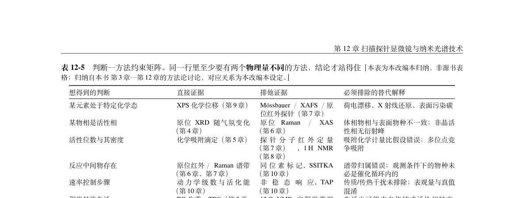

# 版式与查阅体验

本项目是 PDF 方法手册，UI 重点是“从问题找到方法、从公式找到假设、从引用回到证据”。本轮对最新 310 页 PDF 抽看 53 页缩略图，清单见 [pdf-audit.json](pdf-audit.json)，不作逐页排版合格保证。

## R2-U01 · P2 · 两个不编号区块的目录和书签提前一页

位置：`main.tex:60–67`、`style/preamble.tex:234–245`。

| 入口 | 书签目标页 | 实际标题页 |
|---|---:|---:|
| 跨方法综合应用 | 303 | 304 |
| 符号、缩写与索引 | 305 | 306 |

当前 `main.tex` 先发出 `\phantomsection\addcontentsline`，随后输入正文；`\chapterheadstar` 再执行 `\needspace`，可能把标题推到下一页，锚点仍留在上一页。PDF 文本与书签目标已实测，源码注释也承认这一遗留，但注释页码已过期。

建议在决定标题落页之后统一创建目录项和目标锚点。不要靠手工改书签页码。验收不仅比较页号，还需点击导读、十二章、综合应用、索引四类入口，确认目标标题在视口内；连续构建两次仍一致。

## R2-U02 · P2 · 综合应用与索引保留第 12 章页眉

位置：`style/preamble.tex:234–245`，与 `chapters/ch13-synthesis.tex`、`chapters/ch90-backmatter.tex` 的标题调用有关。

PDF p.305、307、309 的奇数页页眉仍为“第 12 章 扫描探针显微镜与纳米光谱技术”，实际已是综合应用或术语索引。视觉上的右侧分节信息也继承了上一方法。原因是非编号标题没有像编号章一样更新 mark。

建议非编号区块显式维护左右页眉，索引页用“符号、缩写与索引”等实际位置。验收须同时抽看奇、偶页与长表续页，不只看区块首页。

## 设计建议（不计入 16 项缺陷）

1. **密度优先压缩重复解释。** p.236 的纠错说明、p.299–300 的密集段落表明文字已经很密。先整理“公式—条件—读图—互证”重复句，再决定删减；不要继续普遍缩字号。p.310 留白多，但末页自然收尾本身不是错误，宜与 p.309 的索引尾部一起调整分页。
2. **把状态与知识主体分层。** 行内短注只保留会影响使用的限制；长篇 OCR 核对过程移入可定位的勘误条目。当前 p.310 是状态类别介绍，不是能逐条关闭的勘误表；建议列 ID、式号、受影响结论、临时使用限制、核对状态和证据页。
3. **让配图有明确读法。** 保留已有方法选择树与示意图。每张图用一句话说明输入、主要观察和不能据此单独推出什么；实验曲线、模型曲线、概念示意分清。来源标注不替代图例和单位。
4. **补可操作的导航。** 索引目前多以章为单位。优先给高频查询词（BET、WP、Rct、MAS 等）增加主定义链接和关键公式链接；“上一节”改为显式引用，尤其第 11 章实际引入顺序为 a、b、d、e、c，c 中“紧接在前”的基础内容已被 e 隔开。
5. **做一轮实际尺寸验收。** 选择方法树、密集表、长公式、谱图、索引五类页面，在 A4 100% 与普通笔记本整页显示下检查图注、坐标与灰色来源。记录最小可读字号、溢出和查找耗时，避免仅凭高倍截图宣布可读。

建议的小任务验收：给首次读者“判断内扩散影响”“区分阻抗的扩散尾与吸附弧”“找到某式的原书依据”三项任务，记录路径和卡点。当前两项导航缺陷应先修，再评估内容重组收益。
