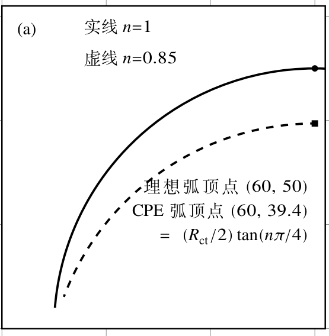
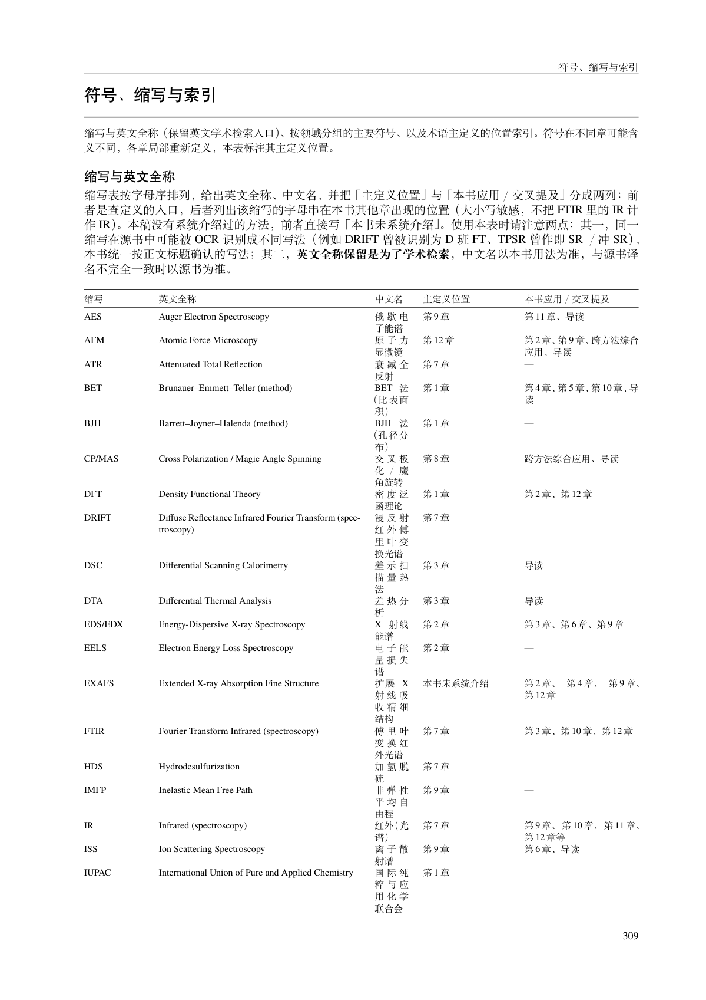

# PDF 阅读与排版评审

本轮 UI 指教材 PDF 的图文布局、索引与阅读流程；仓库托管页面不是教材前端应用。以下问题均在实际构建的 PDF 中确认，不仅来自源码推断。

## R4-U01（P2）：图 11-5 左图说明文字仍被 CPE 虚线穿过

**位置：** `chapters/parts/ch11-d.tex:579–585`，PDF p.273。节点以右下角锚定、宽 28 mm，但多行文字向左上延伸后进入虚线弧内。

上轮的弧顶、主要裁切及面板标记已经修复，但“理想弧顶点”的文字起始位置仍被 CPE 虚线穿过。把节点锚点移到空白处不代表整个文本框避开了数据曲线。[完整页面](evidence/p273.png) 可核对上下文。

**影响：** 注释与曲线相互干扰，读者更难分清用于讲解的两类弧；自动检查又给出 PASS，后续可能直接放行。

**建议：** 给说明独立的空白区域，或使用图外短图例；按完整文字边界和曲线路径安排位置，保留参数及弧顶信息。不要仅用遮白大框盖住教材要展示的曲线。

**验收：** 重编译后查看整页及 200%–300% 放大图，三行说明均不与实线/虚线相交；图中字和坐标刻度在正文阅读尺度仍清晰。R3-U01 只能标记“部分完成”。工具漏检的独立修复任务见 [R4-W01](03-workflow.md)。

## R4-U02（P2）：缩写表新增列后，中文全称被压成每行两三个字

**位置：** `chapters/ch90-backmatter.tex:26`，PDF p.309–311。

当前表格列定义为 `p{18mm}p{60mm}X p{26mm}p{34mm}`。固定列已占 138 mm，叠加列间距后，余下的中文 `X` 列成为瓶颈。p.309 的 DRIFT 中文全称分成 5 行，p.310 的 SSITKA 中文全称分成 6 行；相邻列则留有大量纵向空白。表格延伸到 3 页。

[第二页证据](evidence/p310.png)。这是宽度分配导致的阅读成本，不是文字缺失或截图缩放错误。新增“主讲位置/出现位置”的语义有用，应保留。

**建议：** 给中文全称合理宽度，并让英文名称可伸缩；或者在同一名称单元格分行放置中英文，压缩可用短链接表达的章节列。先以 DRIFT、SSITKA 等长名称做布局样例，再更新全表。不要用全表缩小字号来追求页数。

**验收：** 中文名称可按正常短语阅读，不再形成每行两三个字的窄列；长英文名称不会溢出；保留主讲/出现的区别、跨页续表表头及正确书签。页数作为结果记录，不把强行压回一页作为硬指标。

## 阅读流程建议（不另计缺陷）

1. 内容修改后，按照“正文解释→图及图注→参数反演例子→索引入口”走一遍完整读者路径；本轮 CPE 与 Warburg 问题分别发生在这个路径的解释和操作环节。
2. 图文视觉检查必须使用最终 Release PDF，并记录看过的页号；机器门禁和人眼抽查各自保留结果。
3. 信息密度以可读性为前提：先处理缩写表的窄列和图注占位，再考虑空白优化，不通过更小字号掩盖布局问题。
